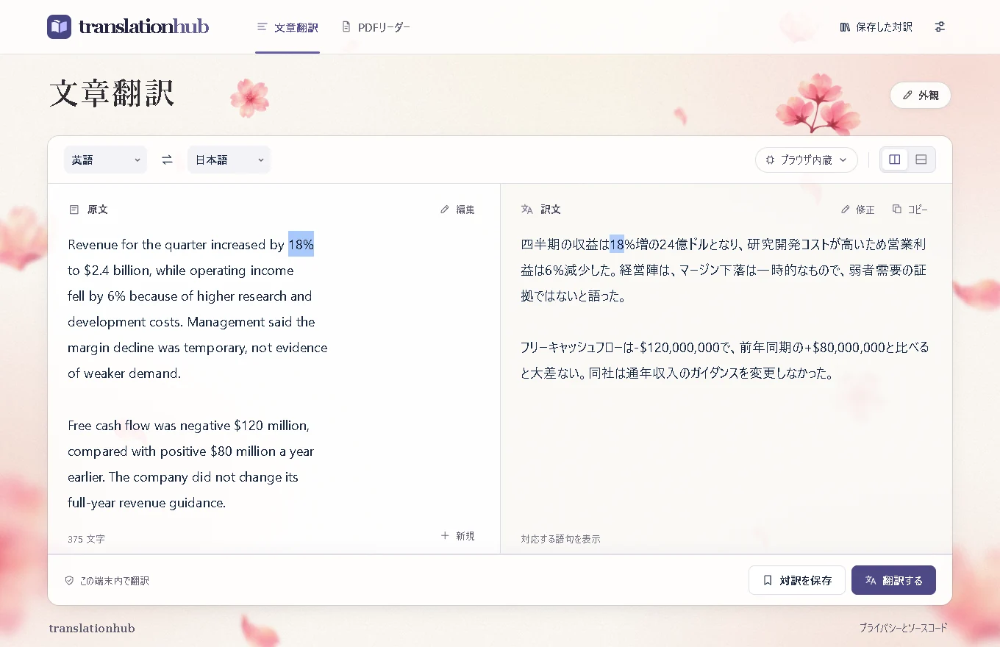

# translationhub

文章とPDFの対訳を自分の端末で読むためのWebアプリです。日本語UI、登録不要、広告なし。A local-first reading workspace for parallel text and PDFs.

**[Web版を開く](https://translationhub.waxyghost64.chatgpt.site) · [ローカル版のソースをダウンロード](https://github.com/yuuu343/translationhub/archive/refs/heads/main.zip)**

## 文章を翻訳する

原文と訳文の言語を選び、文章を貼り付けて「翻訳する」を押します。翻訳欄のエンジン名を押すと、使うモデルとデータの送信先を確認・変更できます。[Google翻訳との比較で使った原文と実際の訳文](https://translationhub.waxyghost64.chatgpt.site/quality/index.html)

英日・日英の文章では、対応ブラウザーで「PLaMo 3 Translate · ブラウザー」が初期選択になります。最初の翻訳時に利用条件を確認して約573 MBのモデルを取得すると、OllamaやAPIキーを用意せずに端末内で翻訳できます。初回ダイアログから他のエンジンも選べます。PLaMoは同じ文書の直前の段落を参照します。日英翻訳では、直前の原文と訳文がともに短い場合に対訳も参照します。段落の参照は設定で切り替えられます。Built with PLaMo. [モデルの利用条件](dist/vendor/plamo/PLAMO-LICENSE-ja.txt)

画面の文字認識（Windowsの `Win + Shift + T` など）から直接貼り付けられます。本文の途中にある折り返しをつなぎ、空行で区切られた段落や箇条書きは区別します。軽量ローカルとブラウザー内蔵には完結した文を、ブラウザー版PLaMoやOllamaなどのエンジンには段落を渡します。非常に長い段落は分割します。原文と保存ファイルには、貼り付けたときの改行が残ります。

タブ区切りの表やMarkdown表では行・列・数値セルの位置を保持します。ローカルの英日・日英翻訳では、認識できる測定値、通貨と桁、百分率などを原文と照合します。訳で値が変わった場合は、対応する値を記号に置き換えて再翻訳し、返答中の各記号を検査してから値を戻します。式やコードの綴りも照合対象です。[検証した文章と結果](docs/translation-quality.md)

- 上部のアイコンで左右・上下の配置を切り替えます。原文・訳文の欄は文章の長さに合わせて広がり、ページをスクロールして最後まで読めます。
- 「外観」で、淡い桜の「花霞」、ツバメが滑空する「燕の空」、橙と金色の花が浮かぶ「陽だまり」を選べます。背景の濃さと原文・訳文の面の透明度は別々に調整できます。背景の動きは端末の設定に従い、いつでもオン・オフを選べます。
- 自分の写真、書体、文字サイズ、行間も「外観」で設定できます。写真はブラウザー内で処理・保存されます。
- 訳文で気になる箇所をクリックして「修正」を押すと、その文や段落を手直しできます。修正した箇所の語句対応は結び直せます。
- 翻訳後に原文か訳文の語句をドラッグすると、反対側の対応箇所を着色します。手動で結んだ語句、文全体、または一致する表記を優先します。端末内エンジンでは選んだ語句の訳を同じ文中で照合する場合もあります。確定できない場合は対応文を示します。「語句を結ぶ」で自分で指定した範囲は対訳ファイルに保存できます。
- 「対訳を保存」でこのブラウザーに保存します。「保存した対訳」から再開・削除・ファイルの書き出しができます。書き出したJSONには原文と訳文が平文で含まれます。ブラウザーのデータを消去する前や、Web版とローカル版の間で移すときにはファイルに書き出してください。
- `Ctrl / ⌘ + Enter` で翻訳・中止、`Ctrl / ⌘ + S` で対訳を保存します。

## PDFを読む

PDFリーダーにファイルをドロップします。PDF.jsが端末内で原本を描画し、翻訳時は選択したページのテキストを段落・ブロックごとにエンジンへ渡します。元のページを確認しながら、紙面上の訳文と文字を拡大できる読書表示を切り替えられます。

「作業を保存」で原本を含む `.thpdf` をダウンロードします。再開時はそのファイルを同じ画面にドロップしてください。書き出したHTMLとMarkdownはテキスト対訳として使えます。画像だけのスキャンにはテキスト層が必要です。複雑な表、縦書き、数式と本文が混在する箇所では抽出順や上書き位置がずれることがあります。

紙面を残すには「書き出し」から印刷用ページを作成します。ページ範囲と「訳文のみ」または「原文・訳文」の順序を選んでから、ブラウザーの印刷で「PDFに保存」を選択してください。元の図表を画像で保持し、翻訳した文字に選択・検索できるテキストを重ねます。一度に20ページまでで、用紙と解像度による画像サイズの上限もあります。

EasyReadを使っている場合、ローカル版から明示的にPDFを端末内のEasyReadへ渡せます。その操作はEasyReadの文献庫にコピーを作ります。EasyRead側のモデル、保存、ネットワーク設定が適用されます。

## 手元で起動する

1. ZIPを展開するかリポジトリをクローンします。
2. Python 3.10以降が使えるWindowsでは `start.bat` を開きます。macOS・Linuxでは `sh start.sh` を実行します。Pythonのパッケージ追加やNodeのビルドは不要です。
3. ブラウザーで `http://127.0.0.1:8771/` を開きます。起動用ターミナルで `Ctrl+C` を押すと終了します。

ブラウザーを開かずにサーバーだけ起動するには `python server.py` を使います。サーバーはループバックアドレスのみで待ち受けます。

| エンジン | 接続とデータの行き先 |
| --- | --- |
| ブラウザー内蔵 | ブラウザーが対象言語のTranslator APIを提供する場合に利用できます。言語データの取得後は端末内で処理します。 |
| PLaMo 3 Translate · ブラウザー | 許可するとPFNの固定版の重みをHugging Faceから端末へ取得します。本文や対訳の外部送信はありません。ブラウザーの対応機能と空き容量が必要です。 |
| 軽量ローカル | 初回にHugging Faceから該当言語の重みを取得し、ブラウザーにキャッシュします。英日にはFuguMT、日英にはOPUS-MTを使います。原文は端末内のWeb Workerで処理します。 |
| PLaMo 3 Translate・TranslateGemma・その他のOllamaモデル | Ollamaに対象モデルを用意し、アプリで名前を選択します。モデルの利用条件は各配布元に従います。 |
| Google Cloud Translation | 利用者自身のBasic v2 APIキーを設定し、Googleへの送信を許可します。Googleの利用料はそのキーの契約に帰属します。 |
| Google Cloud · Translation LLM | Googleの翻訳専用LLMを使う場合は、Basic v2のキーとプロジェクトIDまたは番号を設定します。原文と訳文の文字数に応じてご自身のプロジェクトにLLM料金がかかります。[モデル仕様](https://docs.cloud.google.com/translate/docs/translation-llm)・[料金表](https://cloud.google.com/translate/pricing) |
| Google Apps Script | 同梱の `integrations/google-apps-script.gs` を自分のWebアプリとして設定し、接続先とシークレットを入力します。Googleの割当と処理条件が適用されます。 |

Google Cloud · Translation LLMはブラウザーからGoogleへ直接接続します。Ollama・Google Cloudの標準NMT・Apps Scriptの接続には同梱のローカルサーバーを使います。ローカル版では同じ画面から接続できます。公開Web版から接続する場合は `python server.py --allow-origin https://translationhub.waxyghost64.chatgpt.site` で該当サイトだけを許可してください。ブラウザーによってはローカルネットワークへのアクセス許可が必要です。端末内サーバーを外部へ公開する必要はありません。

### 手元のPLaMoで読む

Ollamaを用意した端末で `ollama pull hf.co/pfnet/plamo-3-translate-0.8b-GGUF:Q4_K_M` を一度実行し、ローカル版を起動します。文章翻訳のエンジン名を押して「PLaMo 3 Translate · Ollama」を選び、「接続・モデルを確認」を押します。モデルの取得は約573 MBです。この構成では、貼り付けた本文を端末のOllamaへ段落ごとに渡します。[モデルと利用条件](https://huggingface.co/pfnet/plamo-3-translate-0.8b-GGUF)

## 保存と公開

translationhubには利用者のアカウント、運営用の文書データベース、アクセス解析スクリプトがありません。エンジンの鍵は実行中のメモリで扱い、対訳や設定に含めません。外観設定と保存を選んだ対訳はブラウザーの領域に、書き出したファイルは利用者が指定した場所に残ります。エンジンの切り替えによる自動クラウド送信はありません。ホスティング・モデル配布・外部翻訳の各事業者は接続に必要な通信情報を扱います。

公開時は `dist/` をHTTPSで静的配信します。ローカル接続用Pythonサーバーは利用者のPCで起動します。アプリ本体はMITライセンスです。同梱ライブラリ・フォント・画像・外部のモデルは個別のライセンスに従います。第三者の同梱物は `dist/vendor/`、背景の出典は `dist/assets/` を参照してください。

寄付を募る場合は、運営者が開設した外部の支援ページを `dist/site-config.js` の `fundingPage` に指定します。設定するとフッターにリンクが表示されます。リンクを開くまでは決済事業者への通信は発生しません。決済と本人確認は支援ページ側で行われ、アプリに寄付者情報を取り込む処理はありません。
